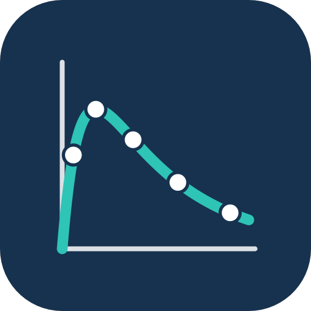
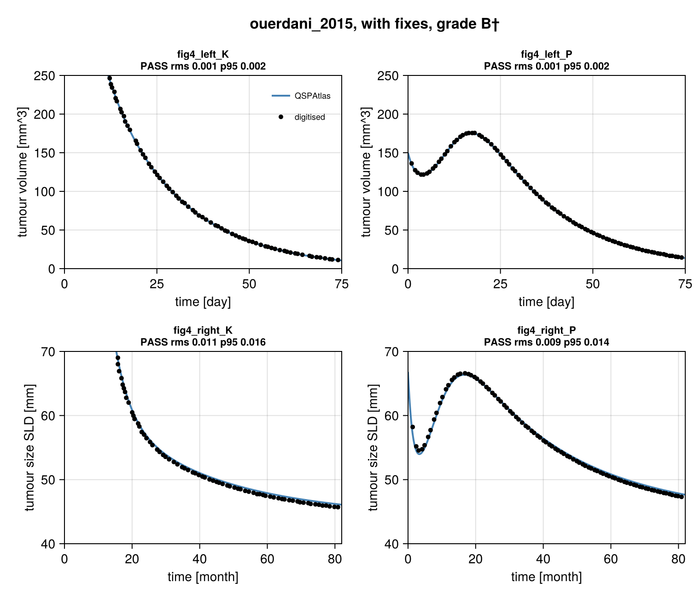
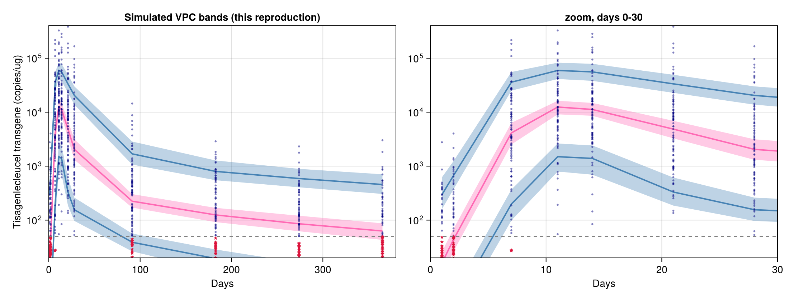
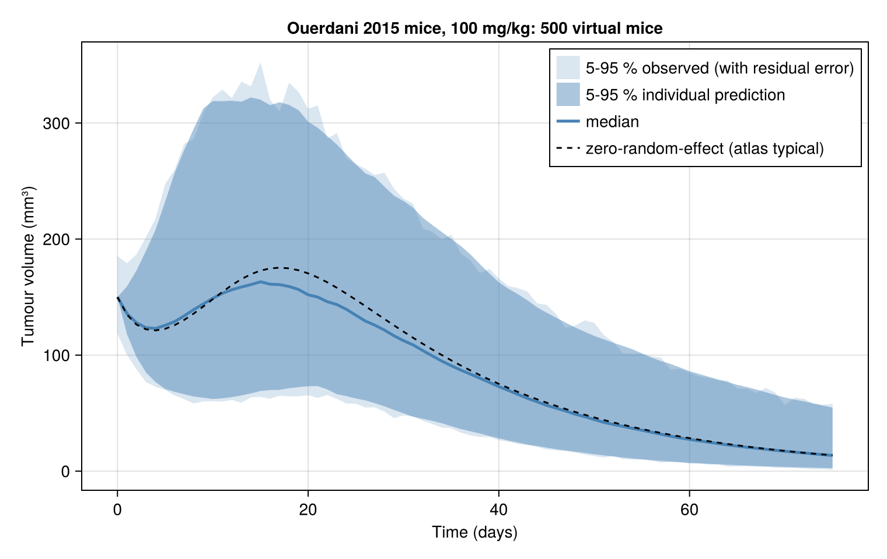
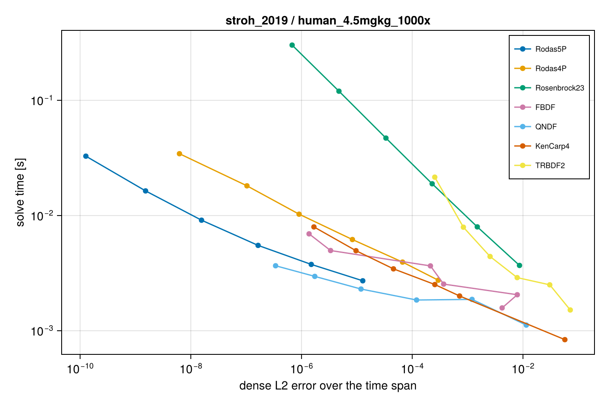

<p align="center"></p>

# QSPAtlas.jl

> **Work in progress.** These readings of the papers have not yet been checked with the
> papers' authors. Corrections are welcome: please open an issue.

**Can published pharmacometric and QSP models be rebuilt from their papers?** This
repository rebuilds published PK/PD and quantitative systems pharmacology models in
Julia ([ModelingToolkit.jl](https://github.com/SciML/ModelingToolkit.jl),
[OrdinaryDiffEq.jl](https://github.com/SciML/OrdinaryDiffEq.jl)), compares them with
the curves in the papers' own figures, and grades each one.

## First results: 6 oncology models from CPT: Pharmacometrics & Systems Pharmacology

**1 of 6 reproduces its target figures, and only after two unstated inputs were read from
the figure itself. The other 5 run once their gaps are filled from documented sources, but
do not match.** Five are graded on typical-value curves and one on a visual predictive check.

Two caveats belong next to these grades. Under the atlas gap-filling rule (values the paper
leaves out may come from cited references or standard constants) none of the six is D;
under the **strict rule**, where only the article and its supplement count, all six are D,
because every one needs at least one value from elsewhere. And some passes rest on inputs
read from the figure being reproduced: all four Ouerdani curves, Lindauer's one passing
target, and 4 of Stroh's 18. The [sensitivity page](https://singhharsh1708.github.io/QSPAtlas.jl/stable/sensitivity/)
shows how each grade changes with the tolerance.

| model | what it is | grade | strict grade | curves passing (as printed / with fixes) | main reason |
|---|---|---|---|---|---|
| [Ouerdani 2015](models/ouerdani_2015/report.md) | pazopanib, tumour growth + angiogenesis (mouse, human) | **B†‡** | D | 0 of 4 / 4 of 4 | initial tumour size and mouse dose group not stated; taken from the figure |
| [Hutchinson 2016](models/hutchinson_2016/report.md) | antiangiogenic transient vessel normalisation | **C** (Fig 2: B, Fig 6: C) | D | 0 of 30 / 22 of 30 | K = T0/V0 printed inverted; Fig 6 drug scale about 100x off Eq. 9, not reproduced |
| [Lindauer 2017](models/lindauer_2017/report.md) | pembrolizumab translational PK/RO/tumour growth | **C** | D | 0 of 5 / 1 of 5 | human blood volume and base scenario not stated; 6 of 64 tornado bars off |
| [Fornari 2019](models/fornari_2019/report.md) | carboplatin bone-marrow toxicity QSP (rat, human) | **C** (Fig 3: B‡, Fig 4: C) | D | did not run / 6 of 9 | equations not closed as printed; rat Figure 3 reproduces once the PK table is read per kg (supported by the supplement's own PK data); human Figure 4 does not |
| [Stroh 2019](models/stroh_2019/report.md) | masked tumour-activated antibody (Probody) QSP | **C** | D | 14 of 35 / 18 of 35 | human cleavage rate given only as an upper bound; "Total Drug" readout undefined |

**Population figures.** Papers whose figures show population spread (visual predictive
checks) are graded on the authors' *simulated* percentile intervals, using the population
simulation layer below; observed-data lines are a diagnostic only.

| model | what it is | grade | strict grade | bands passing (as printed / with fixes) | main reason |
|---|---|---|---|---|---|
| [Stein 2019](models/stein_2019/report.md) | tisagenlecleucel CAR-T cellular kinetics, VPC | **C** | D | 2 of 6 / 4 of 6 | VPC design not stated; rebuilt with the Monolix defaults the paper's files imply, 4 of 6 bands pass, the two left-panel low percentiles do not; result depends on the simulated trial design |

Grades: **A** matches as published; **B** matches after documented fixes, each with
evidence; **B†** a B that needed an input read from the figure being checked; **‡** a B
that rests on at least one fix made after the first comparison with the target figure;
**C** runs but does not match; **D** cannot be run from published information. How the figures were
digitised, how curves are scored, and what may fill a gap are on the method page.

## See it

**A model that reproduces.** Ouerdani 2015, Figure 4: our simulation (blue) against points
digitised from the paper's own curves (black). All four curves pass.



```julia
using QSPAtlas
m = Module(); Base.include(m, joinpath(models_dir(), "ouerdani_2015", "reproduce.jl"))
rep = m.reproduce()        # simulates, scores every curve, writes score.toml and the figure above
grade_label(rep)           # "B†‡"
```

**A population figure that does not.** Stein 2019, Figure 3a: percentile bands from 800
simulated replicates of the 90-patient study. The early expansion matches the authors'
bands; the upper tail and the persistence phase fall below them.



**Population simulation.** 500 virtual mice from the Ouerdani model with the paper's
between-subject variability and residual error.



```julia
mice = virtual_population(500; regimen = Regimen(Dose[]), obstimes = collect(0.0:1.0:75.0),
                          covariate_sampler = rng -> (AUC = 1140.8,))
res = simulate(model, mice; seed = 2015)                  # threaded, reproducible
p = percentiles(res, :P; q = (0.05, 0.5, 0.95))
```

Full script: [`examples/population_ouerdani.jl`](examples/population_ouerdani.jl).

**Performance.** Measured on standard GitHub Actions runners (4 threads, Julia 1.10) by the
Benchmarks workflow ([`benchmarks/population/run.jl`](benchmarks/population/run.jl)); median
of 3 runs after compilation. Runner hardware varies, so three runs are shown as a range.

| model | 100 subjects | 1,000 subjects | 10,000 subjects |
|---|---|---|---|
| Ouerdani 2015 tumour model (2 states) | 0.01 to 0.02 s | 0.08 to 0.15 s | 1.0 to 1.7 s |
| Two-compartment PK, 28 infusions, weight covariate | 0.02 to 0.03 s | 0.19 to 0.44 s | 2.5 to 4.3 s |

About 0.1 to 0.4 ms per simulated subject, roughly linear in cohort size. A visual predictive
check with 200 replicates of a 100-subject cohort (20,000 simulated subjects, 3 quantiles,
14 bins) takes 8 to 13 s.

**Solver choice.** Work-precision benchmarks on the exact problems each model uses
([full results](benchmarks/solvers/results/summary.md)). Explicit Runge-Kutta methods are
fastest on the non-stiff models (Vern7, Tsit5 or BS3, 0.06 to 2.6 ms per solve to a relative
error of 1e-6); on the stiff antibody models (Lindauer 2017, Stroh 2019) they fail, and the
BDF methods QNDF and FBDF are fastest (2 to 4 ms), with Rodas5P best at tight tolerances.



## How models are built

The models are rebuilt by AI coding agents. The agents transcribe each paper's equations,
parameter values and dosing into code, digitise the target figures, run the simulations and
comparisons, and draft the reports. The author reviews every equation, parameter value, fix
and grade against the paper before it is committed. The second implementations under
Validation were written by separate agent sessions with no access to the atlas code. The
next phase, a pre-registered study of a random sample of CPT:PSP models, adds blind rebuilds
by outside pharmacometricians, to compare with the agent rebuilds.

## Validation

- **Against mrgsolve.** The dosing and population machinery agrees with
  [mrgsolve](https://mrgsolve.org) to a relative difference of 1e-8 or better on 26
  deterministic cases (repeated doses, overlapping infusions, bioavailability, lag, steady
  state, resets, simultaneous events) wherever both tools support the case, and within Monte
  Carlo error on population quantiles. Where mrgsolve fails (a lag longer than the dosing
  interval, a new infusion after a reset), QSPAtlas was checked against explicit doses or the
  closed form instead. Scripts: [`validation/mrgsolve/`](validation/mrgsolve/).
- **Second implementations.** Every model was implemented a second time from its paper alone,
  with separate code, by a separate agent session (not yet by outside people); no
  transcription error was found. This compares simulations only, not the digitising.

Details: [validation page](https://singhharsh1708.github.io/QSPAtlas.jl/stable/validation/).

## How it works

```
models/<author_year>/
├── model.jl       # equations and parameter values as printed, each value with its source
├── protocol.jl    # dosing, targets, tolerances, documented fixes, benchmark problems
├── reproduce.jl   # simulate, compare with digitised figure points, write score.toml + figures
├── reference/     # digitised points (one CSV per curve) and the settings that regenerate them
├── figures/       # comparison plots, regenerated paper figures, digitising overlays
├── score.toml     # grade and per-curve errors
├── report.md      # targets, results, fixes with evidence, problems found in the paper, review
└── notes.md       # research notes: transcribed equations, parameter sources, target-freeze record
```

- Targets are the authors' own simulation lines, chosen and frozen before any comparison.
  For these first six models the freeze is recorded in each model's notes but cannot be
  checked from the public history; new models get a public freeze tag before the first
  simulation.
- A curve passes when the RMS distance from the digitised points to the simulated curve is
  at most 1.5 % of the figure's axis box and the 95th percentile at most 3 %.
- Re-estimating parameters never counts as a fix; recalibration is reported separately.
- Each report has a review section recording what was checked, what was disputed and
  how it was settled.

```julia
using QSPAtlas
m = Module(); Base.include(m, joinpath(models_dir(), "ouerdani_2015", "reproduce.jl"))
rep = m.reproduce()   # simulates, compares, writes score.toml and figures
```

`test/runtests.jl` reruns every model and fails if any grade or curve result changes.

## Population simulation

A minimal population simulation layer for reproducing published population figures, with NONMEM-style datasets, built on ModelingToolkit:

- dosing regimens: bolus, repeated doses (`ii`, `addl`), infusions (overlapping),
  bioavailability, lag time, steady state (`ss`), resets;
- `Subject`s with baseline and time-varying covariates, `PopulationModel` with
  between-subject variability and additive, proportional, combined or exponential error;
- `simulate` for one subject or a cohort, reproducible per (replicate, subject) and
  independent of thread count;
- `percentiles`, `vpc` with Monte Carlo standard errors, and plots.

```julia
# `model` is a PopulationModel (see examples/population_ouerdani.jl for a full one)
regimen = Regimen(100.0; cmt = :central, ii = 24.0, addl = 6)      # 100 every 24 h, 7 doses
pop = virtual_population(500; regimen, obstimes = collect(0:1.0:168))
res = simulate(model, pop; seed = 1)
v = vpc(model, pop; endpoint = :conc, q = (0.05, 0.5, 0.95), bins = collect(0:12.0:168), replicates = 200)
```

See `examples/population_ouerdani.jl` for 500 virtual mice from the Ouerdani model.

## Also in the repository

- `benchmarks/solvers/`: work-precision benchmarks of OrdinaryDiffEq solvers on the exact
  problems used for each figure.
- `benchmarks/calibration/`: Turing.jl (Bayesian) and PEtab.jl (maximum likelihood)
  recalibration of the Hutchinson model against the paper's own mean tumour data.
- `tools/digitise/`: the pixel digitiser used for every reference curve.

## Licences and sources

The MIT licence ([LICENSE](LICENSE)) covers the code only. The six papers are open access
on PubMed Central under Creative Commons licences: Ouerdani 2015, Lindauer 2017, Stroh 2019
and Stein 2019 are CC BY-NC-ND 4.0, Fornari 2019 is CC BY-NC 4.0, Hutchinson 2016 is CC BY
4.0. No paper figure images or supplement files are included. The reference CSVs and
`digitise.toml` files hold coordinates read from the published figures, and the models restate
the papers' equations and parameter values. These are facts taken from the cited articles and
remain subject to the articles' terms where those apply; the MIT licence does not change that.
The matrices transcribed from Stroh 2019's supplement for its structural check are not in the
repository (they were in earlier commits); the check reads them from a local folder. Per-paper licences, attribution statements, the files derived from each paper
and the open questions are in [DATA_LICENSES.md](DATA_LICENSES.md).
