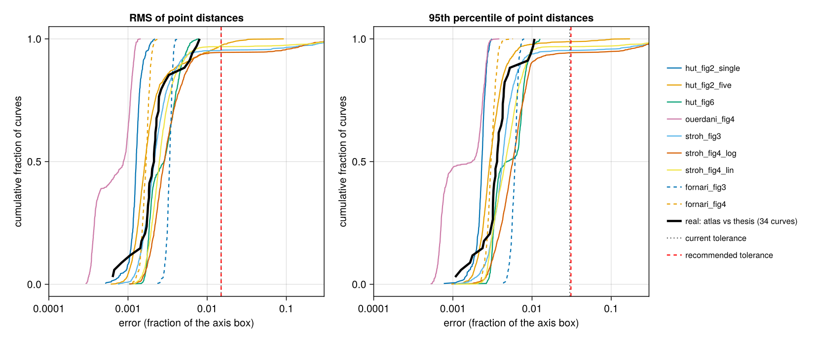
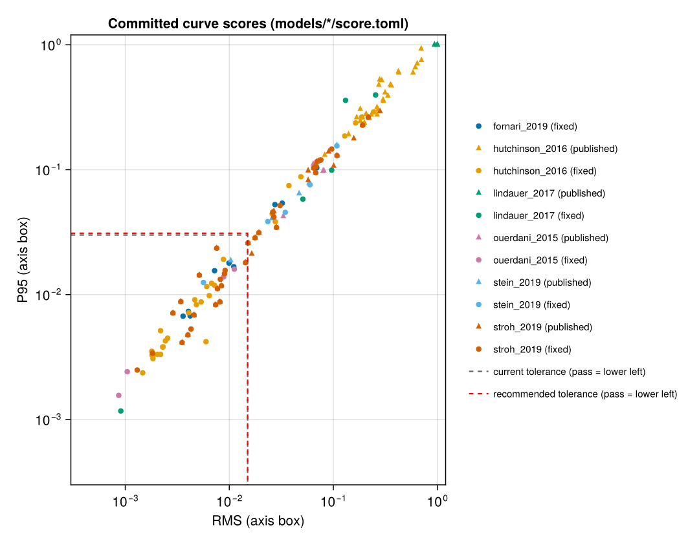

# Digitising error study

The pass rule for a curve (RMS of point-to-curve distances <= 0.015 and their 95th percentile
(P95) <= 0.03 of the axis box, `src/compare.jl`) was set by judgement. This study measures how large
the error from digitising alone is, in the same units and with the same metric. It has two parts:

- **A. Synthetic.** Known curves are drawn at the real panel sizes, saved as JPEG like the PMC files,
  traced with the atlas tools and rules, and scored against the known curve.
- **B. Real figures.** The atlas reference CSVs are compared with the same curves taken from the first
  authors' theses, where the figures are vector graphics or higher-resolution rasters.

Summary: when a trace passes the overlay check, digitising error stays far inside the current
tolerance. The worst panel type has a 99th percentile of 0.0077 (RMS) and 0.0157 (P95). The real
figures agree: across the 34 curves that could be checked against a thesis, the worst values are
0.0080 (RMS) and 0.0107 (P95). The recommended rule (below) gives RMS 0.015 and P95 0.031. Under it,
no committed curve result changes.

## Files

| file | what it does |
|---|---|
| `atlas_metric.jl` | Loads `src/reference.jl` and `src/compare.jl` as a module, so scoring is `QSPAtlas.compare_curve` itself. |
| `jpeg_quality.jl` | Reads the quantisation tables and sampling factors of the PMC JPEGs and estimates their IJG quality. |
| `panels.jl` | Inventory of every digitised panel: axis-box size in pixels from the tick calibrations, scales, tracing rule (`results/panels.csv`). |
| `measure_lines.jl` | Line widths of the target curves in the real images (`results/line_widths.csv`). |
| `synth.jl` | Part A: render, compress, calibrate, trace, score (`results/synthetic_runs.csv`, `examples/`). |
| `real_figures/` | Part B: thesis extraction (`ouerdani_thesis.jl`, `hutchinson_svg.py`, `svg_paths.py`), scoring (`compare_real.jl`), figure (`plot_real.jl`). |
| `summarise.jl` | Summary tables, the tolerance rule, and pass/fail changes from the per-curve `rms`/`p95` in `models/*/score.toml` (no rescoring). |
| `plots.jl` | `results/error_distributions.png`, `results/scores_vs_tolerance.png`. |

Run from the repository root:

    julia --project=tools/digitise -t auto tools/digitise/error_study/synth.jl 300 2026   # about 1 min on 8 threads
    julia --project=tools/digitise tools/digitise/error_study/real_figures/compare_real.jl
    julia --project=tools/digitise tools/digitise/error_study/summarise.jl
    julia --project=. tools/digitise/error_study/plots.jl 0.015 0.031

No new packages were needed: `tools/digitise` already provides JPEG writing (ImageIO, through
JpegTurbo), and the plots use CairoMakie from the repository environment. The thesis PDFs and
everything taken from them are kept outside the repository, under `$QSPATLAS_PAPERS/<id>/thesis/`.
The JPEGs in `examples/` are synthetic.

## Inputs measured from the real figures

**JPEG settings.** Every PMC figure used by the atlas has quantisation tables that match the
standard IJG tables at **quality 92** exactly (table mismatch 0). The colour images use 4:2:0 chroma
subsampling. The Ouerdani and Lindauer figures are greyscale. libjpeg-turbo's defaults (quality 92,
4:2:0) therefore reproduce the PMC compression, and Ouerdani-type panels are saved as greyscale.
`results/jpeg_quality.csv` lists the PMC files, and two synthetic files that confirm the same tables
and subsampling.

**Panel geometry** (axis box in pixels, from `results/panels.csv`):

| panel type | models / figures | axis box (px) | y axis | tracing rule in the atlas |
|---|---|---|---|---|
| `hut_fig2_single`, `hut_fig2_five` | Hutchinson Fig 2 (1 or 5 coloured lines) | 264 x 115 | linear | colour mask, median row per column (`trace_rects`) |
| `hut_fig6` | Hutchinson Fig 6 (black T, magenta V, shaded windows, blue dashed C) | 238 x 88 | linear | dark mask and magenta mask, outlier filter (`trace_rects`) |
| `ouerdani_fig4` | Ouerdani Fig 4 (black solid P, black dashed K, greyscale) | 233 x 235 | linear | dark-run centroids, P/K assigned by position around the crossing (`trace_fig4.jl`) |
| `stroh_fig3` | Stroh Fig 3 (3 or 4 lines, hollow circle markers in the line colours) | 296 x 233 | log, 4 decades | hue tracking (`robust_trace`), min_x = 1 d |
| `stroh_fig4_log`, `stroh_fig4_lin` | Stroh Fig 4 a-c / d-e (5 lines) | 180 x 149 | log 6 decades / linear | hue tracking (`robust_trace`) |
| `fornari_fig3`, `fornari_fig4` | Fornari Fig 3 / 4 (red line under translucent blue bands, black markers) | 137 x 126 / 174 x 156 | log, 3 decades | red mask, median row per column (`digitise_run.jl`) |

**Line widths** (perpendicular, `results/line_widths.csv`): Hutchinson Fig 2 is 2.0 px; Hutchinson
Fig 6 is 1.4 px (black) and about 1 px (magenta); Ouerdani is about 1.4 px; Stroh is 1.9 to 2.3 px.
Fornari's line is drawn at 1.5 px. That width could not be measured because the line is everywhere
under the bands, and the red mask finds about 2 px per column in both the real and the synthetic
images.

## A. Synthetic study

Each repetition of a panel type does the following:

1. **Draw.** Random curves are drawn with 8x8 supersampled antialiasing into an axis box of the real
   size. The box sits at a random sub-pixel offset, and the curves are clipped to it.
   - Shapes: tumour growth, a growth with a kinked treatment peak, a dip-and-peak (Ouerdani P), a
     decay from above the frame (Ouerdani K), near-vertical bolus spikes, biexponential PK on a log
     axis, saturating uptake, and repeated-dose sawtooth and nadir curves (Fornari).
   - Panels with several curves give them a shared start, so they overlap and cross.
   - Colours are the MATLAB palette of the figures, with each figure type's dash pattern, shaded
     windows, translucent percentile bands and hollow markers.
2. **Compress.** The image is saved as a quality-92 JPEG and reloaded with the atlas loader.
3. **Calibrate.** Four outward tick marks per axis are located as darkness-weighted sub-pixel
   centroids. Two of them calibrate the axis and the other two are checks. The pair that places the
   check ticks best is used, as in the atlas.
4. **Trace.** The curves are traced with the atlas code. `trace_rects` and `robust_trace` are
   included unchanged from the model folders. The Ouerdani and Fornari rules are copied from their
   scripts, because those scripts run on include. The tracer settings are the ones in the models'
   `digitise*.toml`: colour targets, tolerances, hue windows, outlier filters, `min_x` and thinning
   to `n` points.
5. **Score.** The traced points are scored against the true curve with `compare_curve`.

The study ran 300 repetitions per panel type (seed 2026), which gave 7,649 curves. Of these, 18
could not be traced at all (no seed track or no matching pixels).

Calibration contributes little. The fitted calibration is off by a median of 0.07 px at the axis
ends (95th percentile 0.12 px). Scoring with the exact calibration instead changes the 99th
percentiles by at most 0.0001 (RMS) and 0.0007 (P95).

**All traced curves** (RMS and P95 shown as median / 95th / 99th percentile):

| panel type | curves | RMS | P95 | fail at 0.015 / 0.03 |
|---|---|---|---|---|
| hut_fig2_single | 300 | 0.0013 / 0.0017 / 0.0020 | 0.0023 / 0.0028 / 0.0030 | 0.0% |
| hut_fig2_five | 1494 | 0.0016 / 0.0107 / 0.0226 | 0.0029 / 0.0062 / 0.0480 | 2.8% |
| hut_fig6 | 599 | 0.0028 / 0.0055 / 0.0065 | 0.0048 / 0.0096 / 0.0121 | 0.0% |
| ouerdani_fig4 | 600 | 0.0009 / 0.0012 / 0.0013 | 0.0018 / 0.0027 / 0.0029 | 0.0% |
| stroh_fig3 | 1049 | 0.0021 / 0.0086 / 0.3686 | 0.0042 / 0.0175 / 0.4463 | 4.8% |
| stroh_fig4_log | 1493 | 0.0029 / 0.0713 / 0.3003 | 0.0057 / 0.1266 / 0.4666 | 5.7% |
| stroh_fig4_lin | 1496 | 0.0025 / 0.0064 / 0.3313 | 0.0046 / 0.0098 / 0.4141 | 3.2% |
| fornari_fig3 | 300 | 0.0034 / 0.0038 / 0.0040 | 0.0061 / 0.0071 / 0.0074 | 0.0% |
| fornari_fig4 | 300 | 0.0017 / 0.0020 / 0.0021 | 0.0030 / 0.0037 / 0.0042 | 0.0% |

**The distribution has two parts.** Most traces sit at 0.001 to 0.008. A few percent are gross
failures with RMS 0.05 to 0.5, which come from two causes:

- Hue tracking jumps to another curve where curves cross or leave the frame (Stroh).
- The colour mask picks up the antialiased blend of two neighbouring lines (mostly the yellow line
  of the five-curve Hutchinson panels).

No tolerance can absorb a failure that size. The atlas guards against them with the overlay check:
every trace is drawn over the figure before it is used. Here that check is emulated by rejecting a
trace whose largest point distance exceeds **0.05 of the axis box**, which is 4 to 15 px on these
panels and plainly visible on an overlay. All 34 real atlas curves in Part B pass this check (their
largest point distance is 0.043).

**Accepted traces** (largest point distance <= 0.05):

| panel type | accepted | caught by the check | RMS median / 95th / 99th | P95 median / 95th / 99th |
|---|---|---|---|---|
| hut_fig2_single | 300 | 0.0% | 0.0013 / 0.0017 / 0.0020 | 0.0023 / 0.0028 / 0.0030 |
| hut_fig2_five | 1388 | 7.1% | 0.0016 / 0.0040 / 0.0066 | 0.0029 / 0.0057 / 0.0093 |
| hut_fig6 | 598 | 0.2% | 0.0028 / 0.0055 / 0.0065 | 0.0050 / 0.0097 / 0.0122 |
| ouerdani_fig4 | 600 | 0.0% | 0.0009 / 0.0012 / 0.0013 | 0.0018 / 0.0027 / 0.0029 |
| stroh_fig3 | 998 | 4.9% | 0.0021 / 0.0045 / 0.0061 | 0.0042 / 0.0075 / 0.0119 |
| stroh_fig4_log | 1407 | 5.8% | 0.0028 / 0.0060 / 0.0077 | 0.0055 / 0.0096 / 0.0157 |
| stroh_fig4_lin | 1445 | 3.4% | 0.0025 / 0.0052 / 0.0071 | 0.0045 / 0.0088 / 0.0110 |
| fornari_fig3 | 300 | 0.0% | 0.0034 / 0.0038 / 0.0040 | 0.0061 / 0.0071 / 0.0074 |
| fornari_fig4 | 300 | 0.0% | 0.0017 / 0.0020 / 0.0021 | 0.0030 / 0.0037 / 0.0042 |
| all | 7336 | 3.9% | 0.0021 / 0.0050 / 0.0068 | 0.0037 / 0.0086 / 0.0115 |

## B. Real figures at higher resolution

| atlas figure | thesis source | curves | RMS median / max | P95 median / max |
|---|---|---|---|---|
| Ouerdani Fig 4 | Ouerdani thesis (HAL tel-01496174) Fig 4, 300 ppi raster, PDF p. 96 | 4 | 0.0008 / 0.0011 | 0.0015 / 0.0018 |
| Hutchinson Fig 2 | Hutchinson thesis (ORA) Fig 3.2, vector, PDF p. 85 | 22 | 0.0021 / 0.0060 | 0.0035 / 0.0053 |
| Hutchinson Fig 6 | Hutchinson thesis Fig 3.14, vector, PDF p. 111 | 8 | 0.0040 / 0.0080 | 0.0066 / 0.0107 |

How the comparison was made:

- **Setup.** Each atlas reference CSV, digitised from the PMC JPEG, was scored with `compare_curve`
  against the thesis curve, using the reference's own axes. The thesis curve takes the place of the
  simulation. The thesis plots are the same plots: same axis limits and same curves. Thesis Fig
  3.14(a) is cropped at 75 d, but its T curve agrees to RMS 0.0018.
- **Hutchinson calibration.** Taken from the tick paths in the vector figures; the largest tick
  residual is under 2e-5 of the axis.
- **Ouerdani calibration.** From tick centroids in the 300 ppi raster, with residuals under 0.001 of
  the axis. The Ouerdani thesis curves were traced with the atlas pick rule, so this comparison
  measures resolution and JPEG error but not bias from the rule itself.
- **Biases.** Median signed offsets are within 0.0015 of the axis except in two cases: Hutchinson
  fig2_f V shows +0.002, and fig6_c_V shows +0.0071 (about 0.6 px), where the magenta line runs 1 to
  2 px from the black one. Per-curve values are in `results/real_figures.csv`, and
  `results/real_figures.png` overlays the atlas points on the thesis curves (data only).

**Real compared with synthetic.** The two agree in size. The real medians are 1.3x (Hutchinson Fig
2: 0.0021 against 0.0016) and 1.4x (Fig 6: 0.0040 against 0.0028) the synthetic medians for the same
panel type. For Ouerdani the ratio is 0.9x. The worst real curve (fig6_d_V: RMS 0.0080, P95 0.0107)
lies at about the synthetic 99th percentile for its panel type (0.0065 / 0.0122).

## Recommended tolerance

**Rule.** Tolerance = 2 x the largest per-panel-type 99th percentile of the digitising-only error of
accepted traces, rounded to two significant figures:

- RMS: 2 x 0.0077 = 0.0155, which gives **0.015**.
- P95: 2 x 0.0157 = 0.0313, which gives **0.031**.

In both cases the worst panel type is `stroh_fig4_log`, the 180 x 149 px log panels with five lines.

Why each part of the rule:

- **99th percentile.** A correctly reproduced curve should fail through digitising error alone at most
  about once in a hundred curves. The atlas has 169 curve results.
- **Largest panel type.** One global tolerance is kept, so it must hold for the hardest panel type.
- **Safety factor 2.** On real figures the error ran up to 1.4x the synthetic error. The remaining
  factor covers sources neither part measures:
  - publisher resampling and repeated compression;
  - per-figure calibration slips (Part B found offsets up to 0.6 px);
  - panel types not simulated: Stein bands (vertical metric) and Lindauer bar tips.

**How sensitive the rule is.** The numbers depend on the emulated overlay check:

| overlay check | worst 99th percentile (RMS / P95) | resulting tolerance |
|---|---|---|
| reject traces with any point beyond 0.03 | 0.0074 / 0.0139 | 0.015 / 0.028 |
| reject traces with any point beyond 0.05 (used) | 0.0077 / 0.0157 | 0.015 / 0.031 |
| reject traces with any point beyond 0.1 | 0.0142 (hut_fig2_five) / 0.0185 | 0.028 / 0.037 |

## Effect on the committed scores

The per-curve `rms` and `p95` were read from `models/*/score.toml` (169 curve results, both runs);
nothing was rescored. Full lists are in `results/tolerance_changes_*.csv`.

| tolerance (RMS / P95) | results that change |
|---|---|
| **0.015 / 0.031 (recommended)** | **none** |
| 0.015 / 0.028 (0.03 overlay check) | none |
| 0.016 / 0.032 (rule rounded up) | stroh fig3c_M1S2, both runs (RMS 0.0151, P95 0.0259): fail -> pass |
| 0.012 / 0.024 (safety factor 1.5) | stroh fig4d_100x, both runs (RMS 0.0143, P95 0.0180): pass -> fail |
| 0.028 / 0.037 (0.1 overlay check) | 7 Stroh results fail -> pass: fig3a_M1S1, fig3b_M1S2 and fig3c_M1S2 in both runs, and fig4b_10x in the published run |
| 0.0077 / 0.0157 (99th percentile, no safety factor) | 18 results pass -> fail, among them Ouerdani fig4_right_P/K, Fornari fig3_Neut and fig4b_neut, and 12 Stroh results |
| per panel type, 2 x its own 99th percentile | 8 results pass -> fail: Ouerdani fig4_right_P and fig4_right_K, Fornari fig3_Neut, fig3_Plt and fig4b_neut, Hutchinson fig2_f_V_N21, Stroh fig4d_100x (both runs) |

## Findings beyond the tolerance

- **The current tolerance is supported.** The current values (0.015 / 0.03) are within rounding of
  what the measured rule gives. On accepted traces, digitising error alone fails 5 of 7,336 simulated
  curves (0.07%) at 0.015 / 0.03, and 4 at 0.015 / 0.031.
- **The near-threshold passes are not explained by digitising error alone.** Ouerdani fig4_right_K (RMS
  0.0112) and fig4_right_P (0.0088) have about 10x the digitising error measured for those exact
  curves on the thesis figure (0.0011 and 0.0007). Their residual is a model or input difference, not
  a digitising one. The same holds for Fornari fig3_Neut (0.0110) and Stroh fig4d_100x (0.0143)
  against the synthetic 99th percentiles of their panel types (0.0040 and 0.0071). A tolerance set
  per panel type would fail these curves (last row of the table above).
- **The RMS criterion is not robust to a single bad point.** With n = 60 points, one point 0.12 of
  the axis off adds 0.12 / sqrt(60) = 0.015 to the RMS. That alone fails the curve, while P95 is
  unaffected. In the synthetic five-curve Hutchinson panels this is the most common failure: RMS
  above 0.015 with P95 near 0.003. The method page says one badly traced point cannot fail a curve
  on its own. That holds only for points under about 0.015 sqrt(n) of the axis, so it depends on the
  overlay check removing gross points (or on outlier filters such as the one used in Hutchinson
  Fig 6).

## Limitations

- The overlay check is emulated with the known truth (largest point distance). The atlas operator
  sees only the overlay.
- One renderer (box-filtered supersampling) stands in for MATLAB plus the publisher's processing.
  The real-figure comparison is the check on this, and it covers only Hutchinson and Ouerdani.
- The Ouerdani crossing column is taken from the true curves. The atlas operator reads it from the
  image.
- Not simulated:
  - Stein band edges, which are scored with the vertical metric;
  - Lindauer bar tips, picked by hand;
  - the legends, which the atlas removes with exclusion boxes.
